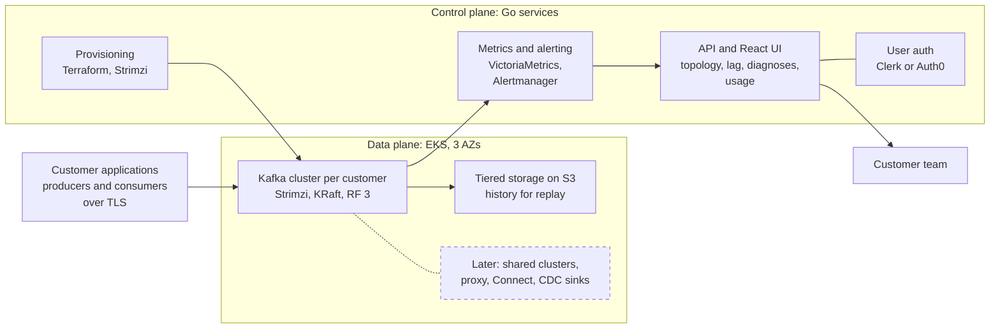
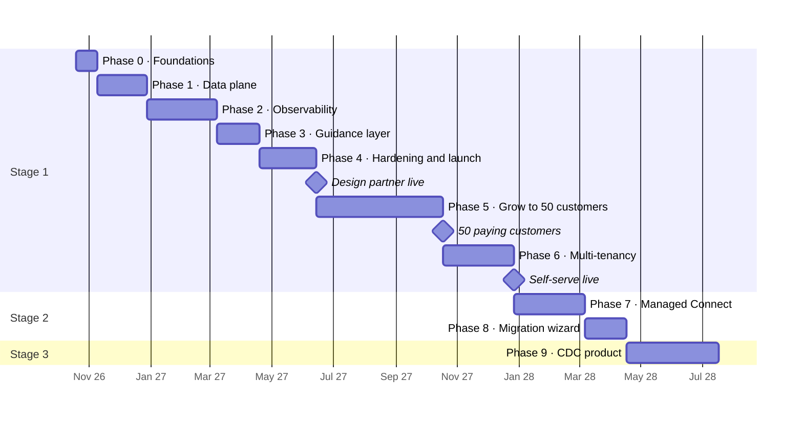

# Changeport: Project Plan

_As of Oct 19, 2026_

## Overview

We will start with a managed Kafka service on AWS where every customer gets a dedicated cluster: one design partner live in about 8 months, then about 50 paying customers by Oct 2027. Multi-tenant shared clusters and self-serve signup follow at that point, and the service then grows into an Artie-style CDC product by mid-2028.

The Kafka service is a deliberate stepping stone. As a standalone business, managed Kafka is crowded (MSK, Confluent Cloud, Aiven, Redpanda), and a one- or two-person team cannot win on breadth. As the backbone of a CDC product, it is essential infrastructure. Every decision in this plan is made so the Kafka platform can later carry CDC pipelines without a rewrite.

Starting with dedicated clusters puts real customers on the platform months earlier. Tenant isolation, quotas, the topic-rewriting proxy and self-serve signup are all deferred until about 50 customers pay, while the choices made now (standard Kafka auth, a tenant label on every metric, per-customer resources generated from one template) keep that step an addition rather than a rewrite.

The roadmap runs in three stages:

1. **Managed Kafka** for teams new to Kafka, differentiated by simplicity and real-time observability: first a dedicated cluster per customer, then multi-tenant and self-serve.
2. **Managed Kafka Connect + Debezium**, which bridges to CDC and also powers migration tooling for experienced teams.
3. **CDC product**: database-to-warehouse replication where Kafka becomes invisible to the customer, starting with Postgres to Snowflake.

## Target users and positioning

The first customer is one design-partner team adopting Kafka for the first time; the next customers, up to about 50, are similar teams onboarded by us onto their own clusters. Self-serve teams follow once multi-tenancy ships, and teams migrating from an existing Kafka setup come after managed Connect. New teams fear confusion and surprise bills more than missing features, so the product wins by making Kafka understandable and its usage-based bill predictable.

| Differentiator | Kafka-service version (stage 1) | CDC version (stage 3) |
| --- | --- | --- |
| Simplicity | Opinionated defaults, one-click clusters, plain-language UI, guardrails | Pipeline setup in minutes, no Kafka concepts exposed |
| Visual understanding | Live topology map of producers, topics and consumers | Pipeline map from source table to warehouse table |
| Real-time observability | Time-based lag, change timeline, diagnoses, alerting | Replication lag, slot health, row-count validation |
| Exactly-once delivery | Idempotent and transactional producers by default, with visible guarantees | At-least-once delivery plus idempotent merges, giving exactly-once results |
| Non-intrusive backfills | Replay history from tiered storage without slowing live consumers | Chunked, watermark-based snapshots that never lock source tables |

Competitors to watch: managed Kafka providers (MSK, Confluent Cloud, Aiven, Redpanda), standalone Kafka observability tools (Conduktor, Kpow, Redpanda Console), and CDC products (Artie, Fivetran, Airbyte, Estuary, Streamkap). Our angle is observability and guidance built in, zero-config and included in the price.

## Architecture

Each customer gets its own Kafka cluster on EKS, while a separate control plane provisions the clusters and collects their metrics.

Customer clients connect directly to their own cluster. All customer clusters run in one EKS cluster per environment, each in its own namespace on dedicated nodes. Terraform builds the base infrastructure, the Go provisioning service creates each customer's resources through the Kubernetes API, and broker and client metrics feed the UI, alerts and usage metering. The dashed box is added later: shared clusters with the proxy in Phase 6, then Connect and CDC in stages 2 and 3.

## Key technical decisions

We self-host Apache Kafka on EKS and buy everything that is not Kafka.

| Decision | Choice | Why |
| --- | --- | --- |
| Kafka hosting | Self-managed on EKS with the Strimzi operator, KRaft mode | MSK's per-broker pricing makes small tenants unprofitable and limits tuning and isolation; Strimzi handles upgrades, certificates and Cruise Control rebalancing |
| Tenancy | Dedicated cluster per paying customer until about 50 paying customers (target Oct 2027). Shared clusters with a virtual cluster per tenant from Phase 6; dedicated clusters stay as a premium tier | Gets paying customers live without building isolation, quotas or self-serve; shared clusters then make a free allowance and small customers economical |
| Tenant isolation | Dedicated clusters: the cluster boundary, with per-application credentials and standard ACLs. From Phase 6: hidden topic prefix, prefix-scoped ACLs, per-tenant credentials, broker quotas (byte rate, request rate, partition and storage caps) | Nothing to isolate until two tenants share a cluster; quotas then prevent noisy neighbors and data leakage |
| Topic name rewriting | Not needed on dedicated clusters. Decide on a Kafka-protocol proxy (Kroxylicious multi-tenancy filter is the leading candidate) at the start of Phase 6 | Hides prefixes on shared clusters so teams keep their topic names; dedicated-cluster customers never need it |
| Multi-tenancy readiness | Tenant label on every metric and alert from day one; every customer's Kubernetes resources generated from one template by the provisioning service | Phase 6 adds tenants instead of relabeling metrics and rewriting provisioning |
| Durability | 3 AZs, replication factor 3, min.insync.replicas 2, rack-aware placement | Survives a full AZ loss |
| Storage | gp3 EBS for hot data, tiered storage to S3 for history | Keeps disks small and enables replay |
| Cross-AZ cost | Follower fetching so consumers read from a replica in their own AZ | Inter-AZ transfer is often the largest AWS cost line |
| Client auth | SASL/SCRAM and mTLS over TLS; public endpoints first, PrivateLink later | Standard protocols keep migration open; PrivateLink is fiddly with Kafka's per-broker addresses |
| Backend language | Go for the API, provisioning, metering and diagnosis services; the KIP-714 telemetry receiver is the one JVM component, because broker plugins must be Java | Strongest Kubernetes and operator ecosystem (client-go, controller-runtime), mature pure-Go Kafka clients, simple static binaries |
| Metrics store | VictoriaMetrics open-source edition, single-node to start | Free, and the docs recommend single-node below one million samples per second; the free cluster version adds multi-tenancy if needed. Enterprise-only features (downsampling, multiple retentions, multitenant vmalert, advanced per-tenant stats) are not needed before Phase 6 |
| Alerting | Alertmanager with per-tenant routing to Slack, PagerDuty and webhooks | Proven, cheap to run |
| Cluster layout | One EKS cluster per environment; each customer's Kafka cluster in its own namespace on dedicated nodes (a Karpenter NodePool with taints per customer) | One control plane fee and one upgrade path instead of 50; dedicated nodes keep brokers isolated |
| Provisioning | Terraform for base infrastructure (VPC, EKS, S3, IAM); the Go provisioning service creates each customer's namespace, NodePool, Strimzi Kafka resource, users and topics through the Kubernetes API | Per-customer changes are fast, automatable and reviewable as code; no Terraform run per customer |
| Kafka version | Newest Kafka 4.x supported by Strimzi | KRaft only, tiered storage and KIP-714 client telemetry |
| AWS accounts | One region, separate dev and prod accounts from the start | Keeps experiments away from customer clusters |
| Repository | One repository for Go services, React app, Terraform and Kubernetes manifests | One place to change a feature end to end |
| Local development | kind with Strimzi on a laptop | Most work needs no AWS |
| User auth | Clerk or Auth0, for the customer team's UI login | Not a differentiator |
| Billing | Usage-based on data processed, rates set later. Design partner invoiced manually; Stripe usage-based billing from Phase 5 | Price follows the value customers get; usage is already measured for observability |
| Frontend | Custom React app, not embedded Grafana | The visual experience is the product |
| First CDC pair | Postgres source, Snowflake destination; other sources and warehouses follow once this pair runs in production | The most common pair for teams replicating an application database into a warehouse, and one every CDC competitor listed above supports, so customers can compare like for like. Debezium, which stage 2 already runs, has a mature Postgres connector built on logical replication; Snowflake's MERGE gives the idempotent merges behind exactly-once results |

## How the differentiators are built

Observability is the largest build and the centerpiece; the guidance layer is how a solo founder scales support.

### Simplicity and guidance

- **Plain language first.** "Orders stream (topic)" and "Billing service is 3 minutes behind", with Kafka terms secondary. Every metric has a one-line explanation.
- **Diagnoses, not dashboards.** A rules engine covering the 15–20 most common Kafka problems explains what is wrong and suggests fixes, e.g. a consumer processing 200 msgs/sec against 350 incoming, with the option to scale up to the partition count. An LLM explanation layer can come later.
- **Guardrails** for classic beginner mistakes: excessive partitions, unkeyed messages where ordering matters, retention shorter than consumer lag, oversized messages, committing offsets before processing. Caught at creation time or flagged in a health score per topic and consumer group.
- **Guided first ten minutes.** Onboarding leads to a working demo: a sample producer, a consumer, and the topology map animating live. Built for the design partner first, then reused as the self-serve signup flow in Phase 6.
- **Generated client snippets** in the main languages, with safe defaults built in.

### Visual understanding and real-time observability

- **Live topology map** of producers, topics and consumer groups, built from broker metrics keyed by client ID and principal plus consumer group data from the AdminClient.
- **Lag in time, not offsets**, computed from committed offsets and message timestamps.
- **Client telemetry without customer instrumentation** via KIP-714 (Kafka 3.7+): clients push metrics to the broker, and a broker-side receiver plugin forwards them into our pipeline.
- **Change timeline**: config changes, ACL edits, rebalances, broker restarts and throttling, overlaid on metric graphs.
- **Live topic tail** with schema decoding, sampling and permission checks.
- **Real-time alerting** on time-lag thresholds, throttling, stuck consumers and error spikes, streamed to the UI over WebSockets or SSE.
- **Usage and projected bill** shown live, from the same metrics that drive usage-based billing, with alerts when usage passes a set budget.

### Exactly-once delivery

- Generated snippets enable idempotent or transactional producers and correct consumer settings by default.
- Transaction coordinator configured for durability (transaction log RF 3, min ISR 2).
- The UI shows each producer's delivery guarantee as a badge, plus transaction health: open transactions, abort rate, and hung transactions that stall `read_committed` consumers.
- Marketing stays honest: end-to-end exactly-once needs consumer cooperation. In the CDC product, the claim is exactly-once results from at-least-once delivery plus idempotent merges, with offsets committed atomically alongside the data.

### Replay and non-intrusive backfills

- **Kafka stage:** replay history into a new consumer group from tiered storage, under separate fetch quotas so live consumers are never starved. Offset resets show a preview, e.g. "this will reprocess 2.1M messages from Oct 3".
- **CDC stage:** watermark-based chunked snapshots interleaved with the live change stream (the technique from Netflix's DBLog paper, also implemented by Debezium incremental snapshots). Chunks are throttled and resumable, and read from a replica when one exists.

## Migration readiness

Migrating teams are a later audience, but two decisions determine whether serving them is easy or a rewrite.

- **Keep customer topic names.** Migrating teams cannot rename every topic across their codebase. On a dedicated cluster their names are untouched; on shared clusters from Phase 6, a protocol proxy that rewrites names transparently keeps it that way. The proxy decision is made before the first shared cluster takes a tenant, so no tenant's connection path changes later.
- **Stay pure Apache Kafka.** No proprietary SDK, standard SASL/SCRAM and mTLS, and per-topic config overrides behind an "advanced" toggle. Anything newcomers don't need is hidden, never removed.

Migration tooling comes almost for free after managed Connect: MirrorMaker 2, the standard migration tool, runs on Kafka Connect. The migration wizard (replication, offset translation, validation and cutover) is therefore a 4–6 week add-on rather than a separate project.

## Roadmap

Phases run in sequence: the design partner goes live after Phase 4 (Jun 2027), about 50 customers pay by the end of Phase 5 (Oct 2027), self-serve opens after Phase 6 (Dec 2027), and the CDC product starts in Apr 2028.

Dates assume a solo engineer starting Oct 19, 2026, using the upper end of each estimate; a second engineer compresses this somewhat. Four gates control the sequence:

1. **After Phase 0:** design partner committed and their data volume known.
2. **After Phase 4:** design partner in production.
3. **After Phase 5:** about 50 paying customers, which triggers multi-tenancy (target Oct 2027).
4. **After Phase 6:** self-serve signup and the free allowance live, and the managed Connect trigger met.

### Milestones

Each phase is a [GitHub milestone](https://github.com/ReneP92/changeport/milestones?direction=asc&sort=due_date).

| Milestone | Weeks | Due | Scope |
| --- | --- | --- | --- |
| [Phase 0: Design partner and foundations](https://github.com/ReneP92/changeport/milestone/1) | 3 | Nov 6, 2026 | Design partner, their data volume, AWS accounts, metrics labels, wireframes |
| [Phase 1: Single-tenant data plane](https://github.com/ReneP92/changeport/milestone/2) | 5–7 | Dec 25, 2026 | EKS, Strimzi, KRaft, tiered storage, auth, KIP-714 telemetry receiver |
| [Phase 2: Observability](https://github.com/ReneP92/changeport/milestone/3) | 8–10 | Mar 5, 2027 | Topology map, time-based lag, change timeline, topic tail, alerting |
| [Phase 3: Guidance layer](https://github.com/ReneP92/changeport/milestone/4) | 4–6 | Apr 16, 2027 | Diagnosis rules, health scores, guardrails, onboarding, exactly-once snippets |
| [Phase 4: Replay, hardening and design-partner launch](https://github.com/ReneP92/changeport/milestone/5) | 6–8 | Jun 11, 2027 | Replay and offset tools, chaos tests, runbooks, docs, design partner in production |
| [Phase 5: Grow to 50 customers](https://github.com/ReneP92/changeport/milestone/6) | 18 | Oct 15, 2027 | Automated dedicated-cluster provisioning, usage metering, Stripe usage-based billing, fleet monitoring and upgrades, onboarding |
| [Phase 6: Multi-tenancy and self-serve](https://github.com/ReneP92/changeport/milestone/7) | 8–10 | Dec 24, 2027 | Shared clusters, quotas, proxy, self-serve signup, free allowance, noisy-neighbor tests |
| [Phase 7: Managed Connect and Debezium](https://github.com/ReneP92/changeport/milestone/8) | 8–10 | Mar 3, 2028 | Hosted connectors, connector health in the observability UI |
| [Phase 8: Migration wizard](https://github.com/ReneP92/changeport/milestone/9) | 4–6 | Apr 14, 2028 | MirrorMaker 2 replication, offset translation, cutover validation |
| [Phase 9: CDC product](https://github.com/ReneP92/changeport/milestone/10) | 13+ | Jul 14, 2028 | Postgres to Snowflake: own sink engine, idempotent merges, watermark backfills, slot monitoring |

Only Phase 0 is broken into issues, plus the proxy decision parked in Phase 6. Later phases get issues once Phase 0 settles the design partner and metrics decisions.

## Team, pricing and operating model

One or two engineers get the design partner live in about 8 months and reach about 50 paying customers a year from now; a second engineer compresses the timeline somewhat but does not halve it, because operations and support grow with every customer cluster.

- **Skills needed:** Go, Kafka and distributed systems, AWS and Kubernetes platform work, frontend for the observability UI, and later data warehouse expertise for the CDC sink.
- **Pricing:** usage-based on the data a customer processes. Exact rates are set later, once the design partner's real usage and cluster costs are known. Every customer sees live usage and a projected bill in the UI, with budget alerts, so usage-based never means a surprise. A free usage allowance arrives with multi-tenancy in Phase 6, when shared clusters make free users cheap to host.
- **SLA:** start at 99.5%, not 99.99%, and target early customers running dev, test and startup workloads.
- **Support:** the guidance layer, docs and tutorials are the support team. Every repeated support question becomes a diagnosis rule or a doc page.

## Risks and mitigations

The biggest risk is getting stuck in stage 1: managed Kafka can absorb all available time without building toward the CDC goal. Dedicated clusters add a second version of it: operating up to 50 separate clusters can consume the time meant for multi-tenancy.

| Risk | Impact | Mitigation |
| --- | --- | --- |
| Stuck in stage 1 | CDC product never ships | Explicit triggers: multi-tenancy at about 50 paying customers (Oct 2027), managed Connect at a trigger set in Phase 0 |
| Operating many dedicated clusters | Upgrades and incidents across up to 50 clusters consume founder time | Fully automated provisioning and upgrades in Phase 5, one fleet view across clusters, identical cluster configs |
| Dedicated clusters for small customers | A 3-broker cluster costs more than a small customer's usage brings in | Set usage rates or a minimum charge from real cluster costs before customer 2; move small customers to shared clusters in Phase 6 |
| Usage-based bills surprise newcomers | Undercuts the "no surprise bills" positioning | Live usage and projected bill in the UI, budget alerts, plain-language usage explanations |
| Single-tenant work doesn't carry over | Phase 6 turns into a rewrite | Tenant label on all metrics from day one, per-customer resources from one template, standard Kafka auth only |
| Design-partner bias | Product shaped around one team's needs | Collect feedback from every customer onboarded in Phase 5; weigh requests against the newcomer positioning |
| Solo on-call | Outages at night, burnout | Modest SLA, a tolerant design partner, chaos testing before launch, thorough runbooks |
| Noisy neighbors (from Phase 6) | One tenant degrades a shared cluster | Quotas and hard partition limits built before the first shared tenant; noisy-neighbor tests in Phase 6 |
| Cross-AZ transfer costs | Margins erode | Follower fetching, tiered storage, usage-based pricing that covers transfer |
| Newcomer support load | Founder time consumed by questions | Diagnosis rules, guardrails, docs; turn repeated questions into product |
| Crowded market | Hard to win customers | Focus narrowly on newcomers and built-in observability; free allowance for acquisition from Phase 6 |
| Overclaiming exactly-once | Credibility loss | Precise language; visible per-producer guarantees |
| CDC source impact (stage 3) | WAL growth fills a customer's disk; snapshots load production | Replication slot monitoring and alerts; chunked, throttled, replica-first snapshots |

## Open questions and next steps

Phase 0 is about finding the design partner and setting up the foundations. Each item is tracked as an issue in the [Phase 0 milestone](https://github.com/ReneP92/changeport/milestone/1).

- [ ] [Find a design-partner customer](https://github.com/ReneP92/changeport/issues/9)
- [ ] [Estimate the design partner's data volume](https://github.com/ReneP92/changeport/issues/3) (data in and out per day, peak throughput, retention)
- [ ] [Set up AWS dev and prod accounts and pick the region](https://github.com/ReneP92/changeport/issues/10)
- [ ] [Define the metrics labeling scheme](https://github.com/ReneP92/changeport/issues/4) (tenant, topic, client), with the tenant label from day one
- [ ] [Wireframe onboarding, the topology map and time-based lag views](https://github.com/ReneP92/changeport/issues/5)
- [ ] [Set the trigger for starting managed Connect](https://github.com/ReneP92/changeport/issues/7)
- [ ] [Secure a domain for Changeport](https://github.com/ReneP92/changeport/issues/8)

Decided:

- [x] Name: Changeport
- [x] Backend language: Go
- [x] Metrics store: VictoriaMetrics open-source edition, single-node
- [x] Pricing model: usage-based on data processed, rates set later
- [x] Multi-tenancy trigger: about 50 paying customers, target Oct 2027
- [x] Infrastructure: one EKS cluster per environment, Terraform for base infrastructure, Strimzi resources created by the Go provisioning service
- [x] Skip the newcomer interviews; learn from the design partner and early customers instead
- [x] [First CDC source and destination](https://github.com/ReneP92/changeport/issues/6): Postgres to Snowflake

Deferred to Phase 6: [decide whether to adopt the topic-rewriting proxy](https://github.com/ReneP92/changeport/issues/2).
