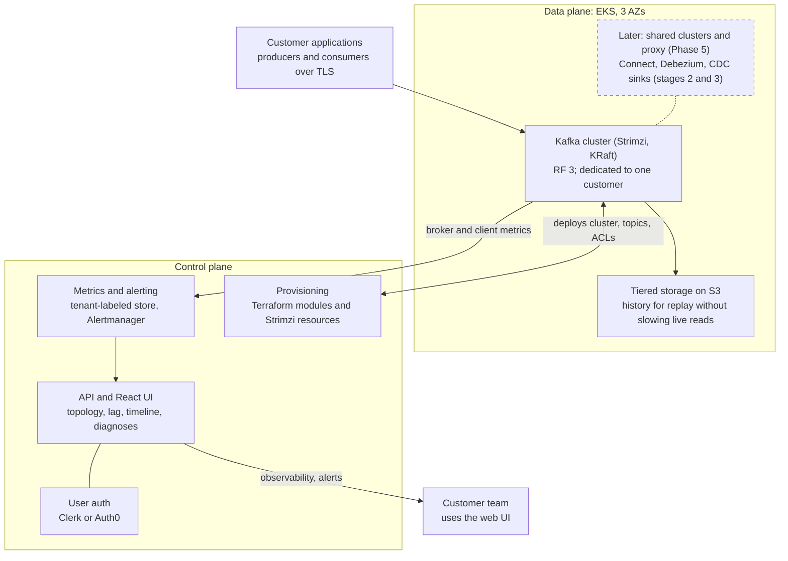
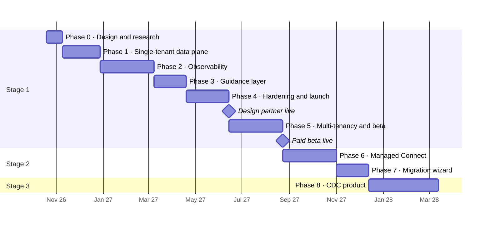

# Changeport: Project Plan

_As of Oct 18, 2026_

## Overview

We will start with a single-tenant managed Kafka cluster on AWS run for one design-partner customer, live in about 8 months. It then becomes a multi-tenant self-serve service for teams new to Kafka with a paid beta at about 10 months, and grows into an Artie-style CDC product within roughly 18 months.

The Kafka service is a deliberate stepping stone. As a standalone business, managed Kafka is crowded (MSK, Confluent Cloud, Aiven, Redpanda), and a one- or two-person team cannot win on breadth. As the backbone of a CDC product, it is essential infrastructure. Every decision in this plan is made so the Kafka platform can later carry CDC pipelines without a rewrite.

Starting single-tenant puts a real customer on the platform months earlier. Tenant isolation, quotas, the topic-rewriting proxy, self-serve provisioning and billing are all deferred to Phase 5, while the choices made now (standard Kafka auth, a tenant label on every metric, Terraform modules parameterized by tenant) keep that step an addition rather than a rewrite.

The roadmap runs in three stages:

1. **Managed Kafka** for teams new to Kafka, differentiated by simplicity and real-time observability: first a single-tenant cluster for one design partner, then multi-tenant and self-serve.
2. **Managed Kafka Connect + Debezium**, which bridges to CDC and also powers migration tooling for experienced teams.
3. **CDC product**: database-to-warehouse replication where Kafka becomes invisible to the customer.

## Target users and positioning

The first customer is one design-partner team adopting Kafka for the first time, running on its own cluster. Self-serve teams new to Kafka follow once multi-tenancy ships, and teams migrating from an existing Kafka setup come after managed Connect. New teams fear confusion and surprise bills more than missing features, so the product wins by making Kafka understandable.

| Differentiator | Kafka-service version (stage 1) | CDC version (stage 3) |
| --- | --- | --- |
| Simplicity | Opinionated defaults, one-click clusters, plain-language UI, guardrails | Pipeline setup in minutes, no Kafka concepts exposed |
| Visual understanding | Live topology map of producers, topics and consumers | Pipeline map from source table to warehouse table |
| Real-time observability | Time-based lag, change timeline, diagnoses, alerting | Replication lag, slot health, row-count validation |
| Exactly-once delivery | Idempotent and transactional producers by default, with visible guarantees | At-least-once delivery plus idempotent merges, giving exactly-once results |
| Non-intrusive backfills | Replay history from tiered storage without slowing live consumers | Chunked, watermark-based snapshots that never lock source tables |

Competitors to watch: managed Kafka providers (MSK, Confluent Cloud, Aiven, Redpanda), standalone Kafka observability tools (Conduktor, Kpow, Redpanda Console), and CDC products (Artie, Fivetran, Airbyte, Estuary, Streamkap). Our angle is observability and guidance built in, zero-config and included in the price.

## Architecture

One Kafka cluster on EKS serves the design partner, while a separate control plane deploys it and collects its metrics.

Customer clients connect directly to their cluster. Provisioning is run by us through Terraform and Strimzi resources, and broker and client metrics feed the UI and alerts. The dashed box is added later: shared clusters with the proxy in Phase 5, then Connect and CDC in stages 2 and 3.

## Key technical decisions

We self-host Apache Kafka on EKS and buy everything that is not Kafka.

| Decision | Choice | Why |
| --- | --- | --- |
| Kafka hosting | Self-managed on EKS with the Strimzi operator, KRaft mode | MSK's per-broker pricing makes small tenants unprofitable and limits tuning and isolation; Strimzi handles upgrades, certificates and Cruise Control rebalancing |
| Tenancy | Single-tenant first: one dedicated cluster for one design partner. Shared clusters with a virtual cluster per tenant from Phase 5; dedicated clusters stay as a premium tier | Gets a real customer live without building isolation, quotas or self-serve; shared clusters remain the economical model for the free tier and small plans |
| Tenant isolation | Single-tenant: the cluster boundary, with per-application credentials and standard ACLs. From Phase 5: hidden topic prefix, prefix-scoped ACLs, per-tenant credentials, broker quotas (byte rate, request rate, partition and storage caps) | Nothing to isolate until a second tenant shares a cluster; quotas then prevent noisy neighbors and data leakage |
| Topic name rewriting | Not needed single-tenant. Decide on a Kafka-protocol proxy (Kroxylicious multi-tenancy filter is the leading candidate) at the start of Phase 5 | Hides prefixes on shared clusters so teams keep their topic names; dedicated-cluster customers never need it |
| Multi-tenancy readiness | Tenant label on every metric and alert from day one; Terraform modules and Strimzi resources parameterized by tenant | Phase 5 adds tenants instead of relabeling metrics and rewriting provisioning |
| Durability | 3 AZs, replication factor 3, min.insync.replicas 2, rack-aware placement | Survives a full AZ loss |
| Storage | gp3 EBS for hot data, tiered storage to S3 for history | Keeps disks small and enables replay |
| Cross-AZ cost | Follower fetching so consumers read from a replica in their own AZ | Inter-AZ transfer is often the largest AWS cost line |
| Client auth | SASL/SCRAM and mTLS over TLS; public endpoints first, PrivateLink later | Standard protocols keep migration open; PrivateLink is fiddly with Kafka's per-broker addresses |
| Metrics store | VictoriaMetrics or Grafana Mimir, both multi-tenant capable; start with the smallest deployment | One tenant needs little; the same store scales to per-tenant metrics and live views |
| Alerting | Alertmanager with per-tenant routing to Slack, PagerDuty and webhooks | Proven, cheap to run |
| Infrastructure as code | Terraform | Reproducible environments |
| User auth | Clerk or Auth0, for the customer team's UI login | Not a differentiator |
| Billing | Design partner invoiced manually; Stripe Billing with flat tiers and internal metering from Phase 5 | No billing system needed for one customer; predictable pricing for newcomers once self-serve opens |
| Frontend | Custom React app, not embedded Grafana | The visual experience is the product |

## How the differentiators are built

Observability is the largest build and the centerpiece; the guidance layer is how a solo founder scales support.

### Simplicity and guidance

- **Plain language first.** "Orders stream (topic)" and "Billing service is 3 minutes behind", with Kafka terms secondary. Every metric has a one-line explanation.
- **Diagnoses, not dashboards.** A rules engine covering the 15–20 most common Kafka problems explains what is wrong and suggests fixes, e.g. a consumer processing 200 msgs/sec against 350 incoming, with the option to scale up to the partition count. An LLM explanation layer can come later.
- **Guardrails** for classic beginner mistakes: excessive partitions, unkeyed messages where ordering matters, retention shorter than consumer lag, oversized messages, committing offsets before processing. Caught at creation time or flagged in a health score per topic and consumer group.
- **Guided first ten minutes.** Onboarding leads to a working demo: a sample producer, a consumer, and the topology map animating live. Built for the design partner first, then reused as the self-serve signup flow in Phase 5.
- **Generated client snippets** in the main languages, with safe defaults built in.

### Visual understanding and real-time observability

- **Live topology map** of producers, topics and consumer groups, built from broker metrics keyed by client ID and principal plus consumer group data from the AdminClient.
- **Lag in time, not offsets**, computed from committed offsets and message timestamps.
- **Client telemetry without customer instrumentation** via KIP-714 (Kafka 3.7+): clients push metrics to the broker, and a broker-side receiver plugin forwards them into our pipeline.
- **Change timeline**: config changes, ACL edits, rebalances, broker restarts and throttling, overlaid on metric graphs.
- **Live topic tail** with schema decoding, sampling and permission checks.
- **Real-time alerting** on time-lag thresholds, throttling, stuck consumers and error spikes, streamed to the UI over WebSockets or SSE.

### Exactly-once delivery

- Generated snippets enable idempotent or transactional producers and correct consumer settings by default.
- Transaction coordinator configured for durability (transaction log RF 3, min ISR 2).
- The UI shows each producer's delivery guarantee as a badge, plus transaction health: open transactions, abort rate, and hung transactions that stall `read_committed` consumers.
- Marketing stays honest: end-to-end exactly-once needs consumer cooperation. In the CDC product, the claim is exactly-once results from at-least-once delivery plus idempotent merges, with offsets committed atomically alongside the data.

### Replay and non-intrusive backfills

- **Kafka stage:** replay history into a new consumer group from tiered storage, under separate fetch quotas so live consumers are never starved. Offset resets show a preview, e.g. "this will reprocess 2.1M messages from Oct 3".
- **CDC stage:** watermark-based chunked snapshots interleaved with the live change stream (the technique from Netflix's DBLog paper, also implemented by Debezium incremental snapshots). Chunks are throttled and resumable, and read from a replica when one exists.

## Migration readiness

Migrating teams are a later audience, but two decisions determine whether serving them is easy or a rewrite.

- **Keep customer topic names.** Migrating teams cannot rename every topic across their codebase. On a dedicated cluster their names are untouched; on shared clusters from Phase 5, a protocol proxy that rewrites names transparently keeps it that way. The proxy decision is made before the first shared cluster takes a tenant, so no tenant's connection path changes later.
- **Stay pure Apache Kafka.** No proprietary SDK, standard SASL/SCRAM and mTLS, and per-topic config overrides behind an "advanced" toggle. Anything newcomers don't need is hidden, never removed.

Migration tooling comes almost for free after managed Connect: MirrorMaker 2, the standard migration tool, runs on Kafka Connect. The migration wizard (replication, offset translation, validation and cutover) is therefore a 4–6 week add-on rather than a separate project.

## Roadmap

Phases run in sequence: the design partner goes live after Phase 4 (Jun 2027), the paid self-serve beta after Phase 5 (Aug 2027), and the CDC product starts roughly 14 months in.

Dates assume a solo engineer starting Oct 19, 2026, using the upper end of each estimate; a second engineer compresses this somewhat. Three gates control the sequence:

1. **After Phase 0:** design partner committed and cluster cost model done.
2. **After Phase 4:** design partner in production and the multi-tenancy trigger met.
3. **After Phase 5:** paid beta live and the managed Connect trigger met.

### Milestones

Each phase is a [GitHub milestone](https://github.com/ReneP92/changeport/milestones?direction=asc&sort=due_date).

| Milestone | Weeks | Due | Scope |
| --- | --- | --- | --- |
| [Phase 0: Design and user research](https://github.com/ReneP92/changeport/milestone/1) | 3 | Nov 6, 2026 | 8–10 newcomer interviews, design partner, cluster cost model, metrics labels, wireframes |
| [Phase 1: Single-tenant data plane](https://github.com/ReneP92/changeport/milestone/2) | 5–7 | Dec 25, 2026 | EKS, Strimzi, KRaft, tiered storage, auth, KIP-714 telemetry receiver |
| [Phase 2: Observability](https://github.com/ReneP92/changeport/milestone/3) | 8–10 | Mar 5, 2027 | Topology map, time-based lag, change timeline, topic tail, alerting |
| [Phase 3: Guidance layer](https://github.com/ReneP92/changeport/milestone/4) | 4–6 | Apr 16, 2027 | Diagnosis rules, health scores, guardrails, onboarding, exactly-once snippets |
| [Phase 4: Replay, hardening and design-partner launch](https://github.com/ReneP92/changeport/milestone/5) | 6–8 | Jun 11, 2027 | Replay and offset tools, chaos tests, runbooks, docs, design partner in production |
| [Phase 5: Multi-tenancy and self-serve beta](https://github.com/ReneP92/changeport/milestone/6) | 8–10 | Aug 20, 2027 | Shared clusters, quotas, proxy, signup, free tier, Stripe, 3–5 beta users |
| [Phase 6: Managed Connect and Debezium](https://github.com/ReneP92/changeport/milestone/7) | 8–10 | Oct 29, 2027 | Hosted connectors, connector health in the observability UI |
| [Phase 7: Migration wizard](https://github.com/ReneP92/changeport/milestone/8) | 4–6 | Dec 10, 2027 | MirrorMaker 2 replication, offset translation, cutover validation |
| [Phase 8: CDC product](https://github.com/ReneP92/changeport/milestone/9) | 13+ | Mar 10, 2028 | Own sink engine, idempotent merges, watermark backfills, slot monitoring |

Only Phase 0 is broken into issues, plus the proxy decision parked in Phase 5. Later phases get issues once Phase 0 settles the design partner, cost model and metrics decisions.

## Team, pricing and operating model

One or two engineers get the design partner live in about 8 months and reach a paid self-serve beta in about 10; a second engineer compresses the timeline somewhat but does not halve it, because operations and support grow as soon as users arrive.

- **Skills needed:** Kafka and distributed systems, AWS and Kubernetes platform work, frontend for the observability UI, and later data warehouse expertise for the CDC sink.
- **Pricing:** the design partner pays a flat monthly price for its dedicated cluster, invoiced manually. From Phase 5, a generous free dev tier is the main acquisition channel, then flat monthly plans with clear limits. Usage is metered internally to enforce quotas, but newcomers never face a byte-metered bill.
- **SLA:** start at 99.5%, not 99.99%, and target early customers running dev, test and startup workloads.
- **Support:** the guidance layer, docs and tutorials are the support team. Every repeated support question becomes a diagnosis rule or a doc page.

## Risks and mitigations

The biggest risk is getting stuck in stage 1: managed Kafka can absorb all available time without building toward the CDC goal. Starting single-tenant adds a second version of it: serving one customer well can delay multi-tenancy indefinitely.

| Risk | Impact | Mitigation |
| --- | --- | --- |
| Stuck in stage 1 | CDC product never ships | Explicit triggers to start multi-tenancy and managed Connect, e.g. after a set number of months or paying users |
| Single-tenant work doesn't carry over | Phase 5 turns into a rewrite | Tenant label on all metrics from day one, tenant-parameterized Terraform and Strimzi resources, standard Kafka auth only |
| Design-partner bias | Product shaped around one team's needs | Keep interviewing newcomer teams through Phases 1–4; weigh requests against the newcomer positioning |
| Solo on-call | Outages at night, burnout | Modest SLA, a tolerant design partner, chaos testing before launch, thorough runbooks |
| Noisy neighbors (from Phase 5) | One tenant degrades a shared cluster | Quotas and hard partition limits built before the first shared tenant; noisy-neighbor tests in Phase 5 |
| Cross-AZ transfer costs | Margins erode | Follower fetching, tiered storage, cost model from Phase 0 |
| Newcomer support load | Founder time consumed by questions | Diagnosis rules, guardrails, docs; turn repeated questions into product |
| Crowded market | Hard to win customers | Focus narrowly on newcomers and built-in observability; free tier for acquisition |
| Overclaiming exactly-once | Credibility loss | Precise language; visible per-producer guarantees |
| CDC source impact (stage 3) | WAL growth fills a customer's disk; snapshots load production | Replication slot monitoring and alerts; chunked, throttled, replica-first snapshots |

## Open questions and next steps

Phase 0 starts with user research and finding the design partner. Each item is tracked as an issue in the [Phase 0 milestone](https://github.com/ReneP92/changeport/milestone/1).

- [ ] [Interview 8–10 teams adopting Kafka for the first time](https://github.com/ReneP92/changeport/issues/1); capture their top confusions and fears
- [ ] [Find a design-partner customer for the single-tenant cluster](https://github.com/ReneP92/changeport/issues/9)
- [ ] [Build a cost model for a dedicated cluster](https://github.com/ReneP92/changeport/issues/3) (brokers, EBS, S3, cross-AZ transfer) to price the design partner
- [ ] [Define the metrics labeling scheme](https://github.com/ReneP92/changeport/issues/4) (tenant, topic, client), with the tenant label from day one
- [ ] [Wireframe onboarding, the topology map and time-based lag views](https://github.com/ReneP92/changeport/issues/5)
- [ ] [Choose the first CDC source and destination](https://github.com/ReneP92/changeport/issues/6) (Postgres to Snowflake is the common starting pair)
- [ ] [Set the triggers for starting multi-tenancy and managed Connect](https://github.com/ReneP92/changeport/issues/7)
- [x] Decide on a name: Changeport
- [ ] [Secure a domain for Changeport](https://github.com/ReneP92/changeport/issues/8)

Deferred to Phase 5: [decide whether to adopt the topic-rewriting proxy](https://github.com/ReneP92/changeport/issues/2), and extend the cost model to per-tenant costs on shared clusters to set free-tier limits and plan prices.
