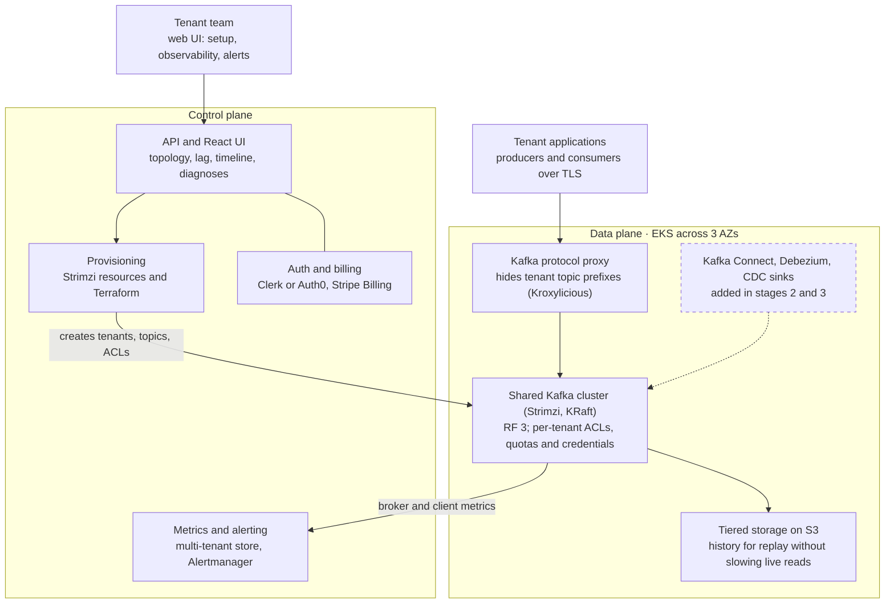
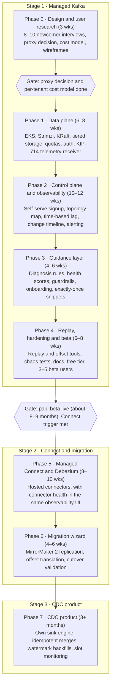

# Changeport: Project Plan

_As of Oct 18, 2026_

## Overview

We will launch a multi-tenant managed Kafka service on AWS for teams new to Kafka, reaching a paid beta in about 8–9 months, then grow it into an Artie-style CDC product within roughly 18 months.

The Kafka service is a deliberate stepping stone. As a standalone business, managed Kafka is crowded (MSK, Confluent Cloud, Aiven, Redpanda), and a one- or two-person team cannot win on breadth. As the backbone of a CDC product, it is essential infrastructure. Every decision in this plan is made so the Kafka platform can later carry CDC pipelines without a rewrite.

The roadmap runs in three stages:

1. **Managed Kafka** for teams new to Kafka, differentiated by simplicity and real-time observability.
2. **Managed Kafka Connect + Debezium**, which bridges to CDC and also powers migration tooling for experienced teams.
3. **CDC product**: database-to-warehouse replication where Kafka becomes invisible to the customer.

## Target users and positioning

The first customers are teams adopting Kafka for the first time; teams migrating from an existing Kafka setup come later, after managed Connect ships. New teams fear confusion and surprise bills more than missing features, so the product wins by making Kafka understandable.

| Differentiator | Kafka-service version (stage 1) | CDC version (stage 3) |
| --- | --- | --- |
| Simplicity | Opinionated defaults, one-click clusters, plain-language UI, guardrails | Pipeline setup in minutes, no Kafka concepts exposed |
| Visual understanding | Live topology map of producers, topics and consumers | Pipeline map from source table to warehouse table |
| Real-time observability | Time-based lag, change timeline, diagnoses, alerting | Replication lag, slot health, row-count validation |
| Exactly-once delivery | Idempotent and transactional producers by default, with visible guarantees | At-least-once delivery plus idempotent merges, giving exactly-once results |
| Non-intrusive backfills | Replay history from tiered storage without slowing live consumers | Chunked, watermark-based snapshots that never lock source tables |

Competitors to watch: managed Kafka providers (MSK, Confluent Cloud, Aiven, Redpanda), standalone Kafka observability tools (Conduktor, Kpow, Redpanda Console), and CDC products (Artie, Fivetran, Airbyte, Estuary, Streamkap). Our angle is observability and guidance built in, zero-config and included in the price.

## Architecture

All tenants share one Kafka cluster on EKS, isolated per tenant, while a separate control plane provisions it and collects its metrics.

Tenant clients connect through the proxy to the shared cluster. The control plane creates tenants, topics and ACLs on it and gathers broker and client metrics for the UI and alerts. The dashed box is added in stages 2 and 3.

## Key technical decisions

We self-host Apache Kafka on EKS and buy everything that is not Kafka.

| Decision | Choice | Why |
| --- | --- | --- |
| Kafka hosting | Self-managed on EKS with the Strimzi operator, KRaft mode | MSK's per-broker pricing makes small tenants unprofitable and limits tuning and isolation; Strimzi handles upgrades, certificates and Cruise Control rebalancing |
| Tenancy | Shared clusters with a virtual cluster per tenant; dedicated clusters later as a premium tier | The only economical model for a small team |
| Tenant isolation | Hidden topic prefix, prefix-scoped ACLs, per-tenant credentials, broker quotas (byte rate, request rate, partition and storage caps) | Prevents noisy neighbors and data leakage |
| Topic name rewriting | Kafka-protocol proxy (Kroxylicious multi-tenancy filter is the leading candidate); decide in Phase 0 | Hides prefixes so migrating teams keep their topic names; retrofitting later means changing every tenant's connection path |
| Durability | 3 AZs, replication factor 3, min.insync.replicas 2, rack-aware placement | Survives a full AZ loss |
| Storage | gp3 EBS for hot data, tiered storage to S3 for history | Keeps disks small and enables replay |
| Cross-AZ cost | Follower fetching so consumers read from a replica in their own AZ | Inter-AZ transfer is often the largest AWS cost line |
| Client auth | SASL/SCRAM and mTLS over TLS; public endpoints first, PrivateLink later | Standard protocols keep migration open; PrivateLink is fiddly with Kafka's per-broker addresses |
| Metrics store | VictoriaMetrics cluster or Grafana Mimir, both multi-tenant | Per-tenant metrics and live views |
| Alerting | Alertmanager with per-tenant routing to Slack, PagerDuty and webhooks | Proven, cheap to run |
| Infrastructure as code | Terraform | Reproducible environments |
| User auth | Clerk or Auth0 | Not a differentiator |
| Billing | Stripe Billing, flat tiers with internal metering | Predictable pricing for newcomers |
| Frontend | Custom React app, not embedded Grafana | The visual experience is the product |

## How the differentiators are built

Observability is the largest build and the centerpiece; the guidance layer is how a solo founder scales support.

### Simplicity and guidance

- **Plain language first.** "Orders stream (topic)" and "Billing service is 3 minutes behind", with Kafka terms secondary. Every metric has a one-line explanation.
- **Diagnoses, not dashboards.** A rules engine covering the 15–20 most common Kafka problems explains what is wrong and suggests fixes, e.g. a consumer processing 200 msgs/sec against 350 incoming, with the option to scale up to the partition count. An LLM explanation layer can come later.
- **Guardrails** for classic beginner mistakes: excessive partitions, unkeyed messages where ordering matters, retention shorter than consumer lag, oversized messages, committing offsets before processing. Caught at creation time or flagged in a health score per topic and consumer group.
- **Guided first ten minutes.** Signup leads to a working demo: a sample producer, a consumer, and the topology map animating live.
- **Generated client snippets** in the main languages, with safe defaults built in.

### Visual understanding and real-time observability

- **Live topology map** of producers, topics and consumer groups, built from broker metrics keyed by client ID and principal plus consumer group data from the AdminClient.
- **Lag in time, not offsets**, computed from committed offsets and message timestamps.
- **Client telemetry without customer instrumentation** via KIP-714 (Kafka 3.7+): clients push metrics to the broker, and a broker-side receiver plugin forwards them into our pipeline.
- **Change timeline**: config changes, ACL edits, rebalances, broker restarts and throttling, overlaid on metric graphs.
- **Live topic tail** with schema decoding, sampling and tenant permission checks.
- **Real-time alerting** on time-lag thresholds, throttling, stuck consumers and error spikes, streamed to the UI over WebSockets or SSE.

### Exactly-once delivery

- Generated snippets enable idempotent or transactional producers and correct consumer settings by default.
- Transaction coordinator configured for durability (transaction log RF 3, min ISR 2).
- The UI shows each producer's delivery guarantee as a badge, plus transaction health: open transactions, abort rate, and hung transactions that stall `read_committed` consumers.
- Marketing stays honest: end-to-end exactly-once needs consumer cooperation. In the CDC product, the claim is exactly-once results from at-least-once delivery plus idempotent merges, with offsets committed atomically alongside the data.

### Replay and non-intrusive backfills

- **Kafka stage:** replay history into a new consumer group from tiered storage, under separate fetch quotas so live consumers are never starved. Offset resets show a preview, e.g. "this will reprocess 2.1M messages from Oct 3".
- **CDC stage:** watermark-based chunked snapshots interleaved with the live change stream (the technique from Netflix's DBLog paper, also implemented by Debezium incremental snapshots). Chunks are throttled and resumable, and read from a replica when one exists.

## Migration readiness

Migrating teams are a later audience, but two decisions made now determine whether serving them is easy or a rewrite.

- **Hide tenant prefixes.** Migrating teams cannot rename every topic across their codebase. A protocol proxy that rewrites names transparently solves this; building it in from the start avoids changing every tenant's connection path later.
- **Stay pure Apache Kafka.** No proprietary SDK, standard SASL/SCRAM and mTLS, and per-topic config overrides behind an "advanced" toggle. Anything newcomers don't need is hidden, never removed.

Migration tooling comes almost for free after managed Connect: MirrorMaker 2, the standard migration tool, runs on Kafka Connect. The migration wizard (replication, offset translation, validation and cutover) is therefore a 4–6 week add-on rather than a separate project.

## Roadmap

Phases run in sequence: paid beta of the Kafka service lands after Phase 4, and the CDC product starts roughly a year in.

Durations assume one or two engineers; the paid beta gate also decides when managed Connect work begins.

### Milestones

Each phase is a [GitHub milestone](https://github.com/ReneP92/changeport/milestones?direction=asc&sort=due_date). Due dates assume a solo engineer starting Oct 19, 2026, using the upper end of each estimate. That puts the paid beta on Jul 2, 2027.

| Milestone | Stage | Weeks | Start | Due |
| --- | --- | --- | --- | --- |
| [Phase 0: Design and user research](https://github.com/ReneP92/changeport/milestone/1) | 1 | 3 | Oct 19, 2026 | Nov 6, 2026 |
| [Phase 1: Data plane](https://github.com/ReneP92/changeport/milestone/2) | 1 | 8 | Nov 9, 2026 | Jan 1, 2027 |
| [Phase 2: Control plane and observability](https://github.com/ReneP92/changeport/milestone/3) | 1 | 12 | Jan 4, 2027 | Mar 26, 2027 |
| [Phase 3: Guidance layer](https://github.com/ReneP92/changeport/milestone/4) | 1 | 6 | Mar 29, 2027 | May 7, 2027 |
| [Phase 4: Replay, hardening and paid beta](https://github.com/ReneP92/changeport/milestone/5) | 1 | 8 | May 10, 2027 | Jul 2, 2027 |
| [Phase 5: Managed Connect and Debezium](https://github.com/ReneP92/changeport/milestone/6) | 2 | 10 | Jul 5, 2027 | Sep 10, 2027 |
| [Phase 6: Migration wizard](https://github.com/ReneP92/changeport/milestone/7) | 2 | 6 | Sep 13, 2027 | Oct 22, 2027 |
| [Phase 7: CDC product](https://github.com/ReneP92/changeport/milestone/8) | 3 | 13+ | Oct 25, 2027 | Jan 21, 2028 |

Only Phase 0 is broken into issues. Later phases get issues once Phase 0 settles the proxy, cost model and metrics decisions.

## Team, pricing and operating model

One or two engineers reach a paid beta in about 8–9 months; a second engineer compresses the timeline somewhat but does not halve it, because operations and support grow as soon as users arrive.

- **Skills needed:** Kafka and distributed systems, AWS and Kubernetes platform work, frontend for the observability UI, and later data warehouse expertise for the CDC sink.
- **Pricing:** a generous free dev tier as the main acquisition channel, then flat monthly plans with clear limits. Usage is metered internally to enforce quotas, but newcomers never face a byte-metered bill.
- **SLA:** start at 99.5%, not 99.99%, and target early customers running dev, test and startup workloads.
- **Support:** the guidance layer, docs and tutorials are the support team. Every repeated support question becomes a diagnosis rule or a doc page.

## Risks and mitigations

The biggest risk is getting stuck in stage 1: managed Kafka can absorb all available time without building toward the CDC goal.

| Risk | Impact | Mitigation |
| --- | --- | --- |
| Stuck in stage 1 | CDC product never ships | Set an explicit trigger to start managed Connect, e.g. after a set number of paying users or months |
| Solo on-call | Outages at night, burnout | Modest SLA, tolerant early customers, chaos testing before launch, thorough runbooks |
| Noisy neighbors | One tenant degrades a shared cluster | Quotas and hard partition limits built before launch; noisy-neighbor tests in Phase 4 |
| Cross-AZ transfer costs | Margins erode | Follower fetching, tiered storage, per-tenant cost model from Phase 0 |
| Newcomer support load | Founder time consumed by questions | Diagnosis rules, guardrails, docs; turn repeated questions into product |
| Crowded market | Hard to win customers | Focus narrowly on newcomers and built-in observability; free tier for acquisition |
| Overclaiming exactly-once | Credibility loss | Precise language; visible per-producer guarantees |
| CDC source impact (stage 3) | WAL growth fills a customer's disk; snapshots load production | Replication slot monitoring and alerts; chunked, throttled, replica-first snapshots |

## Open questions and next steps

Phase 0 starts with user research and the proxy decision. Each item is tracked as an issue in the [Phase 0 milestone](https://github.com/ReneP92/changeport/milestone/1).

- [ ] [Interview 8–10 teams adopting Kafka for the first time](https://github.com/ReneP92/changeport/issues/1); capture their top confusions and fears
- [ ] [Decide whether to adopt the topic-rewriting proxy from day one](https://github.com/ReneP92/changeport/issues/2)
- [ ] [Build a per-tenant cost model](https://github.com/ReneP92/changeport/issues/3) (brokers, EBS, S3, cross-AZ transfer) to set free-tier limits and plan prices
- [ ] [Define the metrics labeling scheme](https://github.com/ReneP92/changeport/issues/4) (tenant, topic, client)
- [ ] [Wireframe onboarding, the topology map and time-based lag views](https://github.com/ReneP92/changeport/issues/5)
- [ ] [Choose the first CDC source and destination](https://github.com/ReneP92/changeport/issues/6) (Postgres to Snowflake is the common starting pair)
- [ ] [Set the trigger for starting managed Connect](https://github.com/ReneP92/changeport/issues/7)
- [x] Decide on a name: Changeport
- [ ] [Secure a domain for Changeport](https://github.com/ReneP92/changeport/issues/8)
