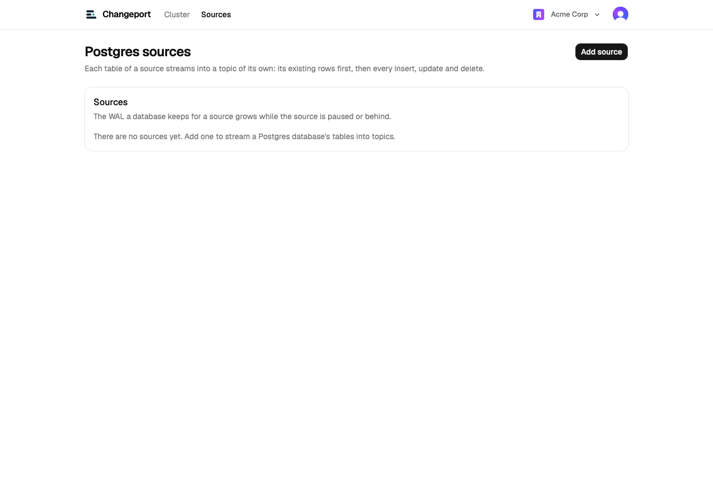
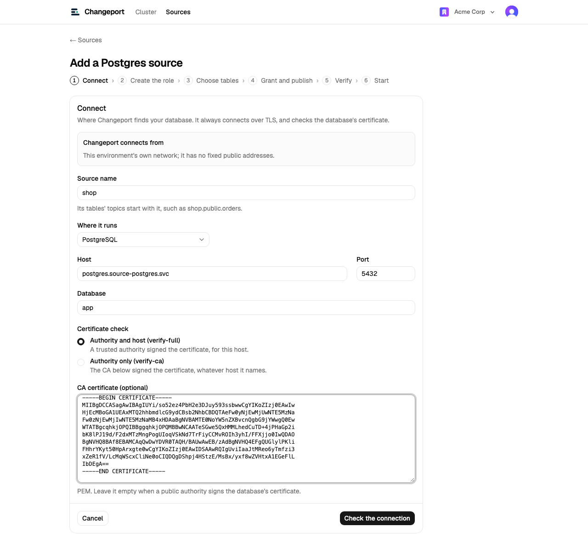
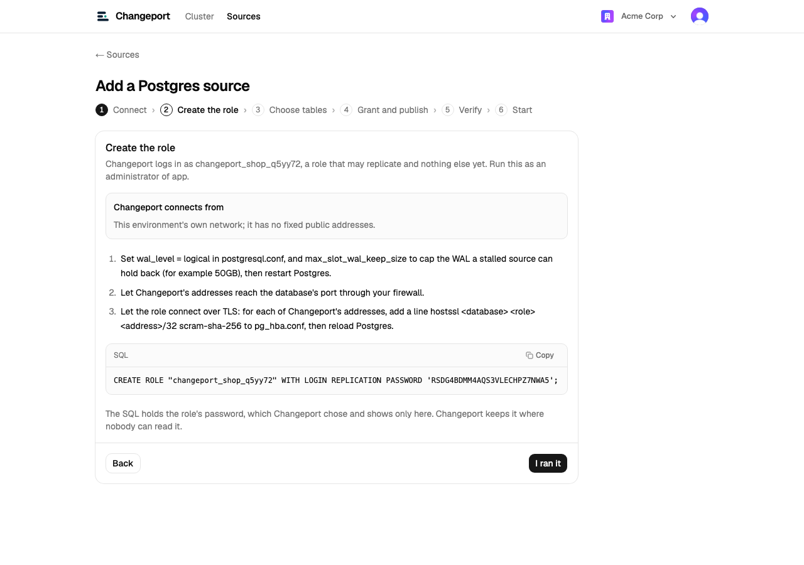
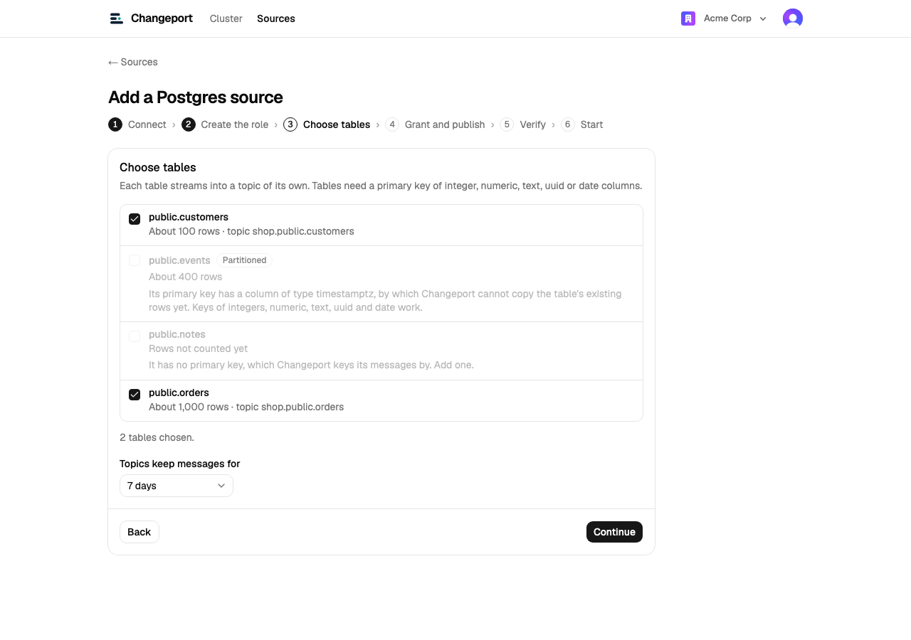
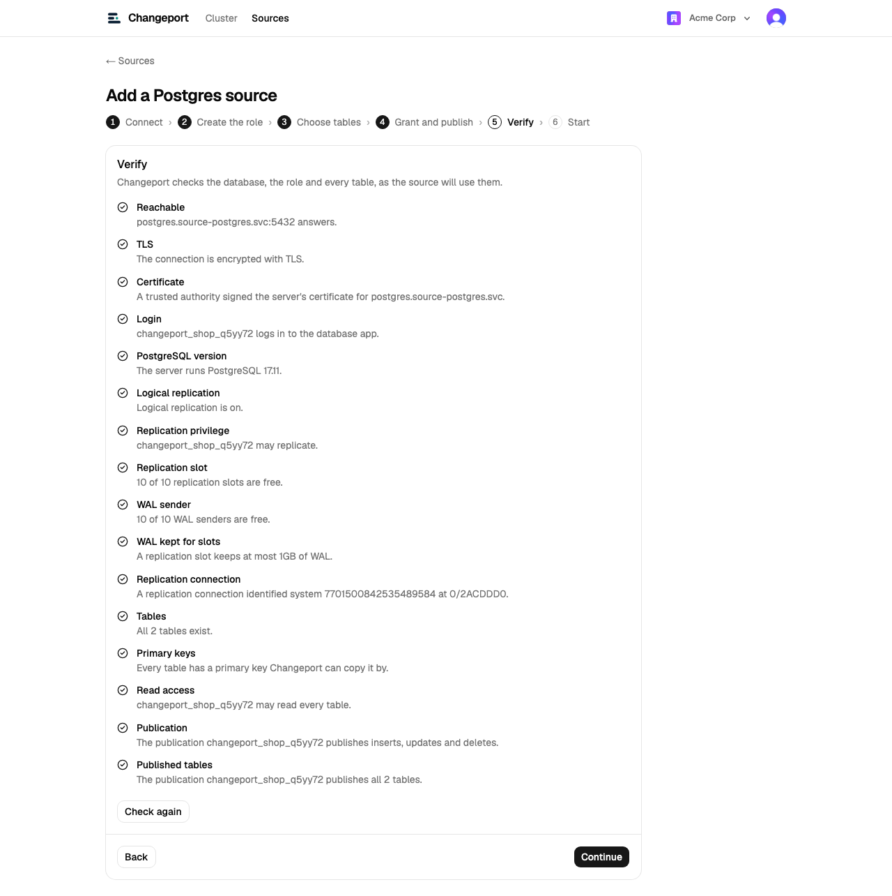
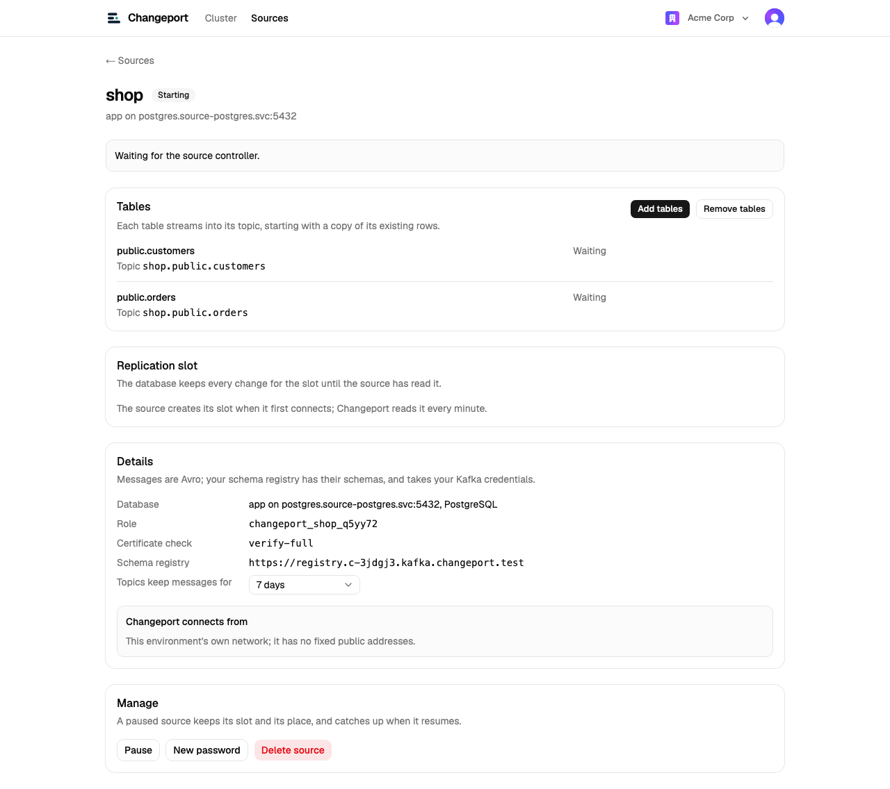
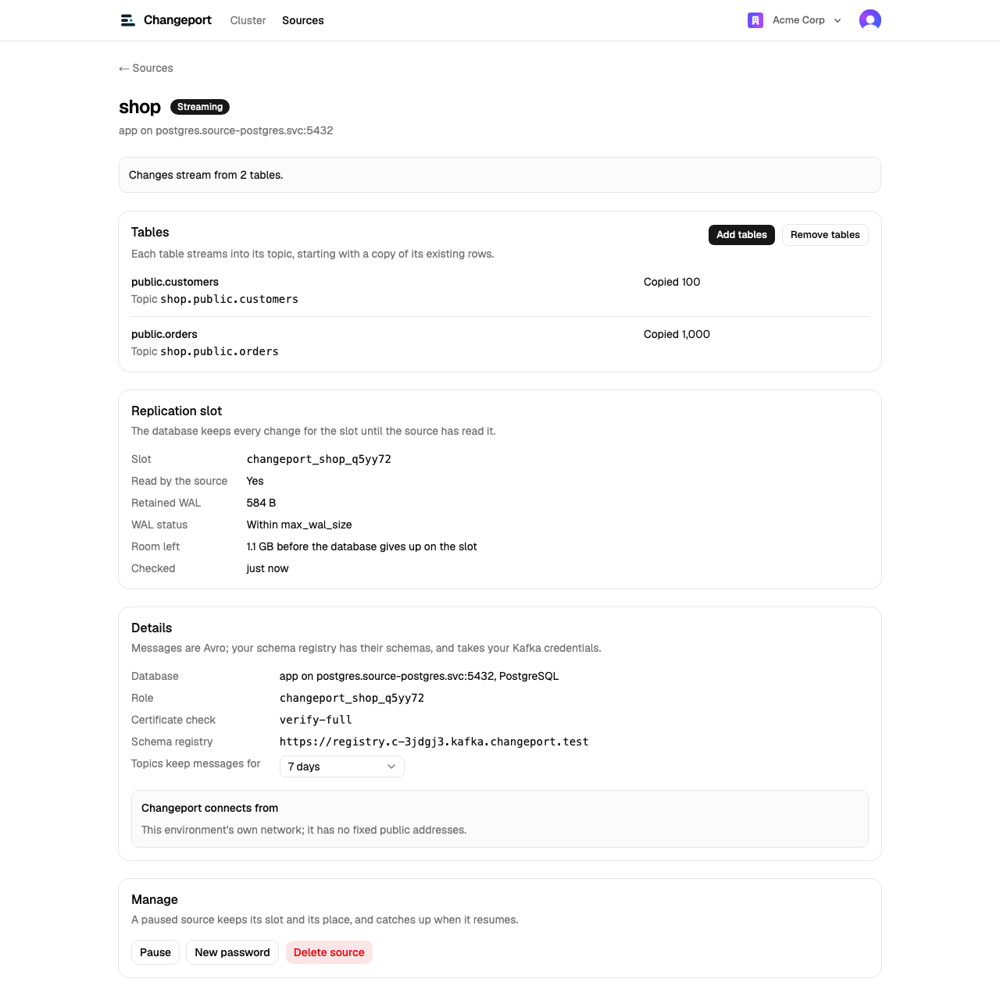
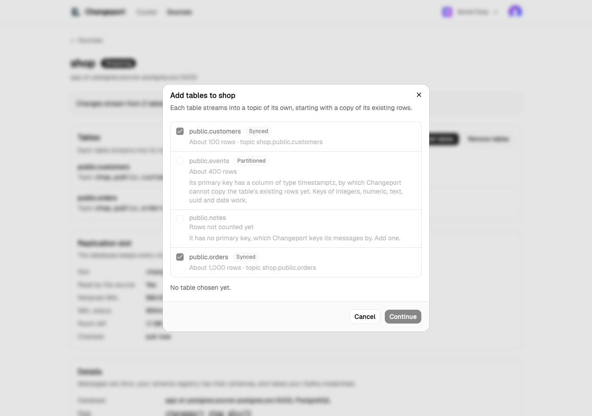
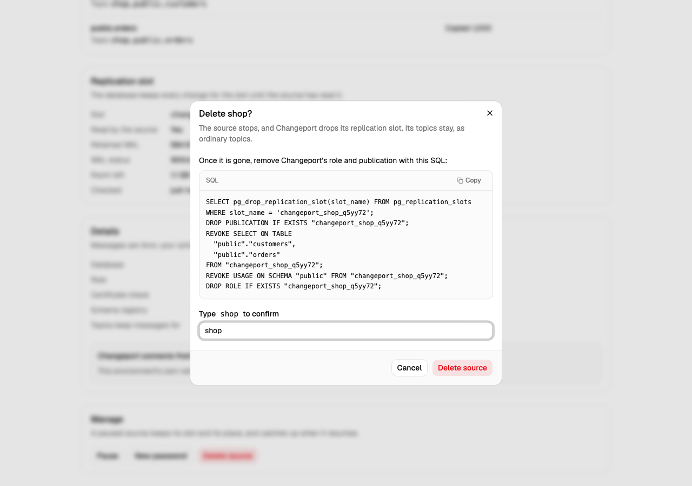
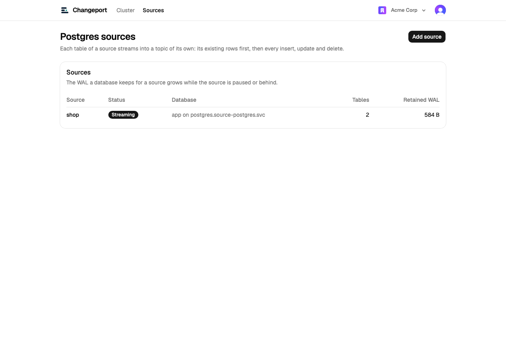

# The console

Every screen of the first console, as `just ui-screenshots` captures it on
kind: an operator provisions Acme Corp and Globex through the operator
console, Acme's admin Ada creates topics and adds a Postgres source,
producers and consumer groups run for a few minutes, and Acme is
deprovisioned again. Each screen also has a
phone version, under the same name ending in `-phone.png`. To capture them
again after changing the console, run `just dev-up` with `.env` filled in,
then:

```bash
just ui-screenshots
```

## Customers

Signing in, through Clerk.


A new customer's cluster getting ready, part by part.


The overview of a ready cluster: how to connect, with `client.properties`
for admins; the brokers' health; throughput; the topics with their
retention, tiering, size and traffic; and how far behind each consumer group
is, in plain language, with its lag over the last hour.


Creating a topic within the guardrails, which the dialog applies as Ada
types.


Deleting a topic names the consumer groups still reading it and takes the
topic's name typed.


What customers see outside their overview: the operator console is closed
to them, an unknown page, and an organization without a cluster.


## Postgres sources

A customer's Postgres sources, under Sources in the header (see
[cdc.md](cdc.md)). Ada adds one through the wizard, against the Postgres on
kind that stands in for a customer's database, and runs its SQL as the
database's owner would. Members of the organization see everything, and
change nothing.



The wizard's six steps. First, where the database is, with the addresses to
allow in and how to check its certificate; Changeport checks that it can
reach it.



Then the role Changeport logs in as, with the password the console chose,
shown only here.



The tables, each with its topic. Those without a primary key Changeport can
use are listed, disabled, with the reason.



After the SQL that grants and publishes the tables, every check, each with
what it found or what to do. The last step starts the source.



The source copies each table's existing rows, then streams every change.





Adding tables: Changeport's source controller lists the database's tables,
as the console cannot log in to it, and the new tables' rows are copied once
their SQL has run.



Deleting a source takes its name typed, and shows the SQL that removes
Changeport's role and publication once it is gone. Its topics stay.





## Operators

Provisioning a customer: its name, which also names its Clerk organization,
its profile, deletion protection and an optional invitation for its first
admin.


The new customer's page follows its cluster as it gets ready.


Every customer, with a dot per part of its cluster.


A protected customer cannot be deprovisioned.


Deprovisioning takes the customer ID typed; the Clerk organization is kept.


## Still to design

The first console is built and refined on the real UI. Still to design are
the guided first ten minutes, from signing up to a live sample producer and
consumer, and the live topology map of producers, topics and consumer
groups; see [Open questions and next steps](PROJECT_PLAN.md#open-questions-and-next-steps).
